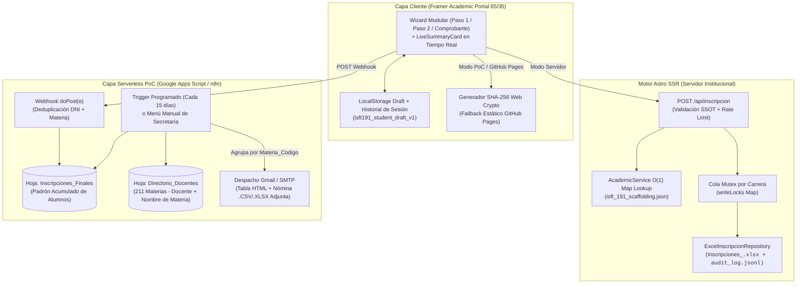
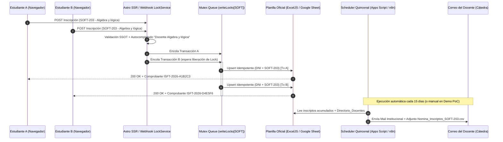

<div align="center">

# Sistema de Inscripción a Exámenes Finales - ISFT N° 191

**Plataforma Académica de Autogestión de Mesas Examinadoras con Persistencia Homogénea en Excel y Despacho Automatizado de Nóminas a Docentes**

[](https://www.typescriptlang.org/)
[](https://astro.build/)
[](https://isft191.edu.ar)
[](./package.json)
[](https://www.conventionalcommits.org/)
[](#3-arquitectura-del-sistema-y-modelo-de-concurrencia)

</div>

---

## 1. Descripción General y Capacidades Clave

El **Sistema de Inscripción a Exámenes Finales del ISFT N° 191 (Bahía Blanca)** unifica las **8 carreras (planes vigentes y en transición) y sus 211 asignaturas** en una única interfaz reactiva alineada con la identidad visual institucional de `isft191.edu.ar`.

Cada solicitud se valida contra el padrón curricular oficial e impacta tanto en libros Excel homogéneos por carrera (cuando corre en servidor Node.js) como en **Google Sheets / Google Apps Script** (o **n8n**) cuando se despliega en modo estático (por ejemplo, en **GitHub Pages**). Los estudiantes reciben únicamente su comprobante oficial verificable en PDF, mientras que las planillas consolidadas de inscriptos se envían automáticamente por correo electrónico a cada docente según el padrón de cátedras cada 15 días (o bajo demanda).

### Características Principales
- **Catálogo Académico Verificado (8 Carreras / 211 Materias):** Sincronización 1:1 con el diseño curricular oficial del instituto (`RS 5847/19`, `RS 5309/24`, `RS 1896/09`, `RS 5312-24`, `RS 1557-07`, `RS 455-23`, `RS 273-03` y `RS 4103/03`), incluyendo el desglose individualizado de los Espacios de Definición Institucional (`EDI 1`, `EDI 2` y `EDI 3`).
- **Autocompletado Determinista de Cátedra (`Docente + Nombre de Materia`):** Al seleccionar una asignatura en el Paso 2, el sistema asigna automáticamente el identificador estandarizado `Docente <Nombre de Asignatura>` para garantizar un cruce 1:1 exacto con el directorio de correos de docentes.
- **Diseño *Framer Academic Portal* Alineado a `isft191.edu.ar`:**
  - Escudo oficial del **ISFT N° 191**, paleta institucional (`#3438AA` azul primario y `#C97026` dorado ocre) y tipografías `Plus Jakarta Sans` + `Inter` + `JetBrains Mono`.
  - Grilla de doble columna (**65% Formulario / 35% Resumen de Inscripción fijo en tiempo real**) con marcos *Double-Bezel* estilo Framer, iconografía vectorial SVG pura (cero emojis de sistema), separadores normalizados con guion medio (` - `) y sin indicadores artificiales tipo LED.
- **Privacidad del Padrón de Inscriptos:** Los alumnos solo visualizan e imprimen su propio comprobante individual (`ISFT-YYYY-XXXXXX`). La descarga de planillas de inscriptos no está expuesta en la interfaz estudiantil; las nóminas se remiten exclusivamente por correo electrónico a cada docente.
- **Persistencia Dual (Servidor Node.js + Webhook Serverless para GitHub Pages):**
  - **Modo Servidor (`ExcelJS`):** Cola de exclusión mutua en memoria (`writeLocks`), deduplicación idempotente por `(DNI + Materia)`, sanitización contra *Formula Injection* y registro append-only (`audit_log.jsonl`).
  - **Modo Simulación / PoC (`Google Apps Script` -> `n8n`):** Envío directo a la planilla maestra en Google Drive personal con envío programado cada 15 días a los correos del directorio docente.

---

## 2. Padrón Curricular Sincronizado

| ID | Código | Carrera | Resolución Oficial | 1° Año | 2° Año | 3° Año | Total Materias |
| :-: | :-: | :--- | :-: | :-: | :-: | :-: | :-: |
| 1 | `SOFT` | Tecnicatura Superior en Desarrollo de Software | `RS 5847/19` | 8 | 8 | 6 | **22** |
| 2 | `ADU-5309` | Tecnicatura Superior en Régimen Aduanero | `RS 5309/24` | 8 | 8 | 7 | **23** |
| 3 | `ADU-1896` | Tecnicatura Superior en Régimen Aduanero | `RS 1896/09` | 10 | 8 | 7 | **25** |
| 4 | `LOG-5312` | Tecnicatura Superior en Logística | `RS 5312-24` | 11 | 9 | 9 | **29** |
| 5 | `LOG-1557` | Tecnicatura Superior en Logística | `RS 1557-07` | 9 | 8 | 7 | **24** |
| 6 | `CONT-455` | Tecnicatura Superior en Administración Contable | `RS 455-23` | 8 | 9 | 7 | **24** |
| 7 | `CONT-273` | Tecnicatura Superior en Administración Contable | `RS 273-03` | 13 | 13 | 12 | **38** |
| 8 | `GEST` | Tecnicatura Superior en Gestoría | `RS 4103/03` | 9 | 9 | 8 | **26** |
| - | **Total** | **8 Planes de Estudio** | **Verificados** | **76** | **72** | **63** | **211** |

---

## 3. Arquitectura del Sistema y Modelo de Concurrencia

### 3.1 Flujo General y Automatización de Envío a Docentes (`flowchart TD`)



### 3.2 Modelo de Concurrencia y Serialización I/O (`sequenceDiagram`)



---

## 4. Especificación de Interfaces y API HTTP

### 4.1 Parámetros de Vista (`GET /`)

| Query Flag | Tipo | Ejemplo | Descripción |
| :--- | :---: | :--- | :--- |
| `carrera` | `string` | `?carrera=SOFT` | Preselecciona automáticamente la carrera e hidrata los contadores de materias por año. |
| `embed` | `0 \| 1` | `?carrera=SOFT&embed=1` | Oculta el encabezado y pie de página institucional para incrustación limpia vía `<iframe>`. |
| `webhook` | `string` | `?webhook=https://script.google.com/...` | Configura y persiste en `localStorage` la URL del Webhook de Google Apps Script o n8n para demostraciones en vivo. |

### 4.2 Registro de Inscripción (`POST /api/inscripcion` y Payload Webhook)

#### Request Payload (`application/json`)
```json
{
  "apellidoNombre": "Jaime Ariel",
  "dni": "34945012",
  "telefono": "2914400469",
  "email": "arij.dev@gmail.com",
  "cohorte": "2023",
  "carreraCode": "SOFT",
  "anioMateria": 2,
  "modalidad": "Regular",
  "materiaCodigo": "SOFT-203",
  "anioCursado": "2026",
  "profesor": "Docente Algebra y lógica"
}
```

#### Response `200 OK` (`application/json`)
```json
{
  "ok": true,
  "comprobanteId": "ISFT191-SOFT-9F4A2C1B",
  "fechaIso": "2026-10-27T14:05:12.410Z",
  "archivoCarrera": "Inscripciones_SOFT.xlsx",
  "duplicado": false,
  "datos": {
    "carreraCode": "SOFT",
    "carreraNombre": "Tecnicatura Superior en Desarrollo de Software",
    "carreraResolucion": "RS 5847/19",
    "apellidoNombre": "Jaime Ariel",
    "dni": "34945012",
    "telefono": "2914400469",
    "email": "arij.dev@gmail.com",
    "cohorte": "2023",
    "anioMateria": 2,
    "anioMateriaLabel": "Segundo",
    "modalidad": "Regular",
    "materiaCodigo": "SOFT-203",
    "materiaNombre": "Algebra y lógica",
    "anioCursado": "2026",
    "profesor": "Docente Algebra y lógica"
  }
}
```

#### Códigos de Estado HTTP
- **`200 OK`**: Inscripción persistida (o actualizada de forma idempotente si `duplicado: true`) y comprobante emitido.
- **`400 Bad Request`**: Fallo de validación defensiva (DNI fuera de rango de 7-9 dígitos, email inválido, o materia inexistente para la carrera y año indicados).
- **`429 Too Many Requests`**: Límite de tasa excedido por IP (`Sliding Window Rate Limiter`).
- **`500 Internal Server Error`**: Error de permisos de sistema de archivos o fallo inesperado en el motor de serialización.

---

## 5. Runbook: Instalación, Compilación y Verificación

### 5.1 Requisitos Previos
- **Node.js:** `>= 22.6.0` (probado en `v24.18.0`)
- **npm:** `>= 10.0.0`

### 5.2 Clonación, Instalación y Generación de Planilla PoC
```bash
git clone --recursive git@github.com:nedder3/formularios-web-isft.git
cd formularios-web-isft
npm install

# Regenerar el libro Excel maestro de PoC (211 materias con "Docente + Nombre de Materia")
node scripts/generate-poc-excel.mjs
```

### 5.3 Ejecución en Desarrollo, Suite de Tests y Build de Producción
```bash
# Servidor de desarrollo en http://localhost:4321 (barra de desarrollo de Astro deshabilitada)
npm run dev

# Ejecutar suite automatizada (Catálogo O(1), Validación SSOT, E2E y Concurrencia 25x)
npm test

# Compilación para producción
npm run build
npm start
```

---

## 6. Estado del Proyecto y Checklist de Evolución

### 6.1 Arquitectura Backend, Datos y Seguridad (Completado)
- [x] **Indexación en Memoria $O(1)$ (`Map` Lookup):** Búsqueda instantánea por carrera, año y código de asignatura en `src/lib/academicService.ts`.
- [x] **Proyección de DTO Ligero para el Cliente:** Serialización compacta en `<script type="application/json" id="isft-catalog-data">` y endpoint cacheado `GET /api/catalogo.json`.
- [x] **Control de Idempotencia y Deduplicación (`DNI + materiaCodigo`):** Evita filas duplicadas si el mismo estudiante vuelve a enviar la misma materia.
- [x] **Registro Transaccional Append-Only (`audit_log.jsonl`) y Sanitización Anti-Formula Injection:** Escapado automático de prefijos ejecutables (`=`, `+`, `-`, `@`) en `src/lib/excelService.ts`.
- [x] **Single Source of Truth (SSOT) en Validación y Rate Limiting:** Esquema compartido cliente/servidor en `src/lib/validation.ts` y limitador de tasa en `src/lib/rateLimit.ts`.
- [x] **Suite de Tests Automatizados (5/5 pasando):** Pruebas unitarias de catálogo, validación SSOT, flujo E2E y concurrencia de 25 escrituras simultáneas (`npm test`).

### 6.2 Rediseño UX/UI y Alineación Institucional `isft191.edu.ar` (Completado)
- [x] **Subdivisión Modular en `src/components/`:** `NoticeBanner.astro`, `WizardStepper.astro`, `StepPersonalData.astro`, `StepSubjectSelection.astro`, `ReceiptTicket.astro` y `LiveSummaryCard.astro`.
- [x] **Layout *Framer Academic Portal* (65% Formulario / 35% Resumen Fijo):** Marcos de doble bisel (*Double-Bezel*), escudo oficial `/logo-isft191.png` y paleta institucional `#3438AA` / `#C97026`.
- [x] **Depuración Visual Estricta:**
  - [x] Desactivación de la Astro Dev Toolbar (`devToolbar: { enabled: false }` en `astro.config.mjs`).
  - [x] Eliminación total de emojis de sistema operativo, separadores ASCII (`//`), puntos medios (`•`) y rayas largas (`—`), unificando todos los separadores en guion medio (` - `).
  - [x] Eliminación de barras de navegación externas ajenas al módulo de inscripción, indicadores tipo LED / `"En vivo"` y etiquetas de `"Compatible SIU Guaraní"`.
  - [x] Eliminación del cajón de descarga de planillas `.xlsx` en la vista del alumno (`ReceiptTicket.astro`) para resguardar la privacidad del padrón.

### 6.3 Automatización de Nóminas a Docentes y Simulación Serverless (Fase 1 PoC -> Fase 2 n8n)
- [x] **Generador de Padrón Docente (`scripts/generate-poc-excel.mjs`):** Creación automática de `planillas-generadas/ISFT191_Padron_Docentes_e_Inscripciones.xlsx` con las 211 materias bajo el formato `Docente + Nombre de Materia`.
- [x] **Autocompletado de Docente en Paso 2 (`src/pages/index.astro`):** Al elegir una asignatura se completa automáticamente `Docente <Nombre de Materia>` para garantizar coincidencia exacta con el directorio de correos.
- [x] **Despliegue de Planilla Maestra en Google Drive Personal (`arij.dev@gmail.com`):**
  - Carpeta en Drive: `ISFT 191 - PoC Inscripcion a Finales` (`ID: 1rKZdAOphvEfXoN06iw3lW0WcvoMy7XId`).
  - Google Sheet activo: `ISFT191_Padron_Docentes_e_Inscripciones` (`ID: 12u9N-3c9aKF51JstFVpH7KREZHHwkhqceWRQq4Uha2g`).
- [x] **Script de Automatización Google Apps Script (`automation/google-apps-script/Code.gs`):** Incluye webhook `doPost(e)`, envío de correos con tabla HTML institucional + adjunto `.csv` por materia (`enviarNominasDocentes`), programación automática cada 15 días (`instalarTriggerQuincenal`) y menú `ISFT 191 - Secretaría` en Google Sheets.
- [x] **Activación de Webhook en Producción PoC (`PUBLIC_APPS_SCRIPT_URL`):** Publicado como Aplicación Web en Google Apps Script y vinculado por defecto en `src/pages/index.astro` (verificado con impacto en tiempo real en `Inscripciones_Finales`).
- [ ] **(Pendiente - Fase 2):** Publicar el frontend estático en **GitHub Pages** y migrar el flujo programado de Google Apps Script a un workflow exportable de **n8n** (`n8n-workflow-isft191.json`).
