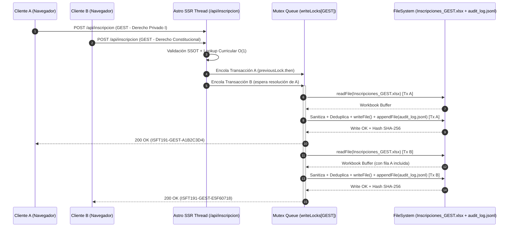

<div align="center">

# Sistema de Inscripción a Exámenes Finales — ISFT N° 191

**Plataforma Académica SSR de Autogestión de Mesas Examinadoras con Persistencia Excel Homogénea y Preparación para SIU Guaraní**

[](https://www.typescriptlang.org/)
[](https://astro.build/)
[](https://isft191.edu.ar)
[](./package.json)
[](https://www.conventionalcommits.org/)
[](#3-arquitectura-del-sistema-y-modelo-de-concurrencia)

</div>

---

## 1. Descripción General y Capacidades Clave

El **Sistema de Inscripción a Exámenes Finales del ISFT N° 191 (Bahía Blanca)** resuelve la fragmentación de formularios estáticos mediante un motor **Server-Side Rendered (Astro SSR)** que unifica las **8 carreras (planes vigentes y en transición) y sus 211 asignaturas** en una única interfaz reactiva. Cada solicitud se valida contra el padrón curricular oficial en el servidor e impacta de forma atómica en libros Excel homogéneos separados por carrera, respetando el esquema estricto de 10 columnas requerido por Secretaría Académica y preparando los payloads para la futura ingesta en **SIU Guaraní**.

### Características Principales
- **Catálogo Académico Verificado (8 Carreras / 211 Materias):** Sincronización 1:1 con el diseño curricular oficial del instituto (`RS 5847/19`, `RS 5309/24`, `RS 1896/09`, `RS 5312-24`, `RS 1557-07`, `RS 455-23`, `RS 273-03` y `RS 4103/03`), incluyendo el desglose individualizado de los Espacios de Definición Institucional (`EDI 1`, `EDI 2` y `EDI 3`).
- **Filtrado Dinámico en Cascada Zero-Reload ($O(1)$ Map Lookup):** Selección progresiva en memoria (`Carrera` $\rightarrow$ `Año de Cursada (1°, 2°, 3°)` $\rightarrow$ `Materias Habilitadas`) con buscador instantáneo, que impide inscripciones cruzadas o errores de tipeo en nombres de asignaturas.
- **Persistencia Excel Homogénea con Cola Mutex e Idempotencia por Carrera:** Generación y actualización de archivos `Inscripciones_<CODIGO_CARRERA>.xlsx` mediante `ExcelJS`, protegida por colas de promesas encadenadas en memoria (`writeLocks`), deduplicación automática por `(DNI + Materia)`, sanitización contra *Formula Injection* y registro de auditoría append-only (`audit_log.jsonl`).
- **Persistencia Local de Legajo con Control Explícito (Draft Caching):** Almacenamiento automático en `localStorage` de los datos personales del alumno con aviso de sesión activa y botón de limpieza para terminales compartidas.
- **Comprobante Criptográfico *Swiss Editorial Ticket* + Historial de Sesión:** Emisión de ticket único (`ISFT191-<CARRERA>-<SHA256_8>`) con resumen acumulativo de materias inscriptas en la sesión y hoja de estilo `@media print` dedicada para descarga directa en PDF.
- **Integración Nativa con WordPress (`isft191.edu.ar`):** Diseño **Institutional Bento Grid + Subtle Liquid Glass** alineado con los tokens de color institucionales (`#3438AA` y `#D97706`) y soporte de query flags (`?carrera=<CODE>&embed=1`) para incrustación transparente vía `<iframe>` o Reverse Proxy.

---

## 2. Padrón Curricular Sincronizado

| ID | Código | Carrera | Resolución Oficial | 1° Año | 2° Año | 3° Año | Total Materias |
| :-: | :-: | :--- | :-: | :-: | :-: | :-: | :-: |
| 1 | `SOFT` | Tecnicatura Superior en Desarrollo de Software | `RS 5847/19` | 8 | 8 | 6 | **22** |
| 2 | `ADU-5309` | Tecnicatura Superior en Régimen Aduanero | `RS 5309/24` | 8 | 8 | 7 | **23** |
| 3 | `ADU-1896` | Tecnicatura Superior en Régimen Aduanero | `RS 1896/09` | 10 | 8 | 7 | **25** |
| 4 | `LOG-5312` | Tecnicatura Superior en Logística | `RS 5312-24` | 11 | 9 | 9 | **29** |
| 5 | `LOG-1557` | Tecnicatura Superior en Logística | `RS 1557-07` | 9 | 8 | 7 | **24** |
| 6 | `CONT-455` | Tecnicatura Superior en Administración Contable | `RS 455-23` | 8 | 9 | 7 | **24** |
| 7 | `CONT-273` | Tecnicatura Superior en Administración Contable | `RS 273-03` | 13 | 13 | 12 | **38** |
| 8 | `GEST` | Tecnicatura Superior en Gestoría | `RS 4103/03` | 9 | 9 | 8 | **26** |
| — | **Total** | **8 Planes de Estudio** | **Verificados** | **76** | **72** | **63** | **211** |

---

## 3. Arquitectura del Sistema y Modelo de Concurrencia

### 3.1 Diagrama de Flujo de Arquitectura (`flowchart TD`)

```mermaid
flowchart TD
    subgraph ClientLayer["Capa Cliente (Bento Grid + Liquid Glass UI)"]
        WP["Portal Institucional WordPress\n(isft191.edu.ar)"]
        UI["Wizard Modular Astro SSR + FSM TS\n(NoticeBanner / WizardStepper / Step1 / Step2 / ReceiptTicket)"]
        Draft["LocalStorage Draft + Session History\n(isft191_student_draft_v1)"]
    end

    subgraph ServerLayer["Motor Astro SSR (Node.js Standalone)"]
        Router["SSR Page Router\n(GET /?carrera=CODE&embed=1)"]
        APICat["Endpoint de Catálogo DTO\n(GET /api/catalogo.json)"]
        APIPost["Endpoint de Registro + Rate Limit\n(POST /api/inscripcion)"]
        APIGet["Endpoint de Exportación\n(GET /api/excel/:carrera)"]
        Validator["Shared SSOT Validator & Sanitizer\n(src/lib/validation.ts)"]
        Catalog["O(1) Indexed Academic Service\n(src/lib/academicService.ts)"]
        Mutex["Per-Career Promise Mutex Queue\n(writeLocks Map<filePath, Promise>)"]
        ExcelEngine["ExcelInscripcionRepository\n(src/lib/excelService.ts)"]
    end

    subgraph StorageLayer["Capa de Datos y Persistencia"]
        JSON[("isft_191_scaffolding.json\n(8 Carreras / 211 Materias)")]
        XLSX[("data/output/Inscripciones_<CODE>.xlsx\n(10 Columnas Homogéneas)")]
        WAL[("data/output/audit_log.jsonl\n(Append-Only Audit Log)")]
    end

    WP -->|Iframe / Reverse Proxy| Router
    Router --> Catalog
    APICat --> Catalog
    Catalog --> JSON
    Router --> UI
    UI <--> Draft
    UI -->|JSON Payload| APIPost
    APIPost --> Validator
    APIPost -->|Lookup O(1)| Catalog
    APIPost -->|Encola Escritura Serializada| Mutex
    Mutex --> ExcelEngine
    ExcelEngine -->|Deduplicación + Escritura Atómica| XLSX
    ExcelEngine -->|Append-Only Log| WAL
    UI -->|Descarga Planilla| APIGet
    APIGet --> XLSX
```

### 3.2 Modelo de Concurrencia y Serialización I/O (`sequenceDiagram`)

Para garantizar que dos alumnos de la misma carrera que envían el formulario en el mismo milisegundo no sobrescriban ni corrompan el archivo `.xlsx`, `src/lib/excelService.ts` implementa una cola de exclusión mutua asíncrona por ruta de archivo (`writeLocks`):



---

## 4. Especificación de Interfaces y API HTTP

### 4.1 Parámetros de Vista SSR (`GET /`)

| Query Flag | Tipo | Ejemplo | Descripción |
| :--- | :---: | :--- | :--- |
| `carrera` | `string` | `?carrera=GEST` | Preselecciona automáticamente la carrera y pre-hidrata los contadores de materias por año en SSR. |
| `embed` | `0 \| 1` | `?carrera=SOFT&embed=1` | Oculta el encabezado y pie de página institucional para incrustación limpia dentro de WordPress. |

### 4.2 Registro de Inscripción (`POST /api/inscripcion`)

Valida los datos del alumno mediante el esquema compartido (`src/lib/validation.ts`) y la correlación estricta `Carrera` $\rightarrow$ `Año` $\rightarrow$ `Materia` antes de impactar en el archivo Excel de la carrera.

#### Request Payload (`application/json`)
```json
{
  "apellidoNombre": "Cricelli Candela Juliana",
  "dni": "43596839",
  "telefono": "2914058716",
  "email": "candecricelli21@gmail.com",
  "cohorte": "2023",
  "carreraCode": "GEST",
  "anioMateria": 1,
  "modalidad": "Regular",
  "materiaCodigo": "GEST-102",
  "anioCursado": "2023",
  "profesor": "Crivelli"
}
```

#### Response `200 OK` (`application/json`)
```json
{
  "ok": true,
  "comprobanteId": "ISFT191-GEST-9F4A2C1B",
  "fechaIso": "2026-10-27T13:05:12.410Z",
  "archivoCarrera": "Inscripciones_GEST.xlsx",
  "duplicado": false,
  "datos": {
    "carreraCode": "GEST",
    "carreraNombre": "Tecnicatura Superior en Gestoría",
    "carreraResolucion": "RS 4103/03",
    "apellidoNombre": "Cricelli Candela Juliana",
    "dni": "43596839",
    "telefono": "2914058716",
    "email": "candecricelli21@gmail.com",
    "cohorte": "2023",
    "anioMateria": 1,
    "anioMateriaLabel": "Primero",
    "modalidad": "Regular",
    "materiaCodigo": "GEST-102",
    "materiaNombre": "Derecho Constitucional",
    "anioCursado": "2023",
    "profesor": "Crivelli"
  }
}
```

#### Códigos de Estado y Manejo de Errores
- **`200 OK`**: Inscripción persistida (o actualizada de forma idempotente si `duplicado: true`) en el libro Excel de la carrera y comprobante emitido.
- **`400 Bad Request`**: Fallo de validación defensiva (DNI fuera de rango de 7–9 dígitos, email inválido, cohorte/año de cursado con formato incorrecto, o materia inexistente para la carrera y año indicados).
- **`429 Too Many Requests`**: Límite de tasa excedido por IP (Sliding Window Rate Limiter).
- **`500 Internal Server Error`**: Error de permisos de sistema de archivos o fallo inesperado en motor de serialización Excel.

### 4.3 Descarga de Planilla Homogénea (`GET /api/excel/:carrera`)

- **Ruta:** `GET /api/excel/GEST` (acepta cualquiera de los 8 códigos: `SOFT`, `ADU-5309`, `ADU-1896`, `LOG-5312`, `LOG-1557`, `CONT-455`, `CONT-273`, `GEST`). Si la variable de entorno `ISFT_ADMIN_KEY` está definida, exige `?token=<KEY>` o `Authorization: Bearer <KEY>`.
- **Respuesta `200 OK`:** Flujo binario `application/vnd.openxmlformats-officedocument.spreadsheetml.sheet` con las **10 columnas homogéneas exactas**:
  1. `Apellido y Nombre`
  2. `DNI`
  3. `Teléfono`
  4. `Dirección de correo electrónico`
  5. `Cohorte`
  6. `Año al que pertenece la materia que quiere rendir` (`Primero` | `Segundo` | `Tercero`)
  7. `MODALIDAD` (`Regular` | `Libre`)
  8. `MATERIA`
  9. `AÑO DE CURSADO`
  10. `PROFESOR`
- **Respuesta `404 Not Found`:** Código de carrera inválido o carrera aún sin inscripciones registradas en disco.

---

## 5. Runbook: Instalación, Compilación y Verificación

### 5.1 Requisitos Previos
- **Node.js:** `>= 22.6.0` (probado en `v24.18.0`)
- **npm:** `>= 10.0.0`

### 5.2 Clonación e Instalación
```bash
git clone --recursive git@github.com:nedder3/formularios-web-isft.git
cd formularios-web-isft
npm install
```

### 5.3 Ejecución en Desarrollo, Suite de Tests y Compilación de Producción (Release)
```bash
# Servidor de desarrollo con Hot-Reload en http://localhost:4321
npm run dev

# Ejecutar suite automatizada (Catálogo O(1), Validación SSOT, E2E y Concurrencia 25x)
npm test

# Compilación SSR para producción (salida en ./dist/server/entry.mjs)
npm run build

# Ejecución del servidor Node.js Standalone en producción
npm start
```

---

## 6. Roadmap de Evolución y Checklist de Auditoría Senior

A continuación se documenta el relevamiento integral de mejoras técnicas, arquitectónicas, de seguridad, testing y experiencia de usuario ejecutadas sobre la plataforma, preservando la identidad institucional del **ISFT N° 191 (`#3438AA` / `#D97706`)** y la compatibilidad con **WordPress** y **SIU Guaraní**.

### 6.1 Estructura de Datos, Complejidad y Persistencia (`academicService.ts` / `excelService.ts`)
- [x] **Indexación en Memoria $O(1)$ (`Map` Lookup):** Reemplazar las búsquedas lineales `.find()` y `.filter()` repetidas en `getCarreraByCode()`, `getMateriasByCarreraAndYear()` y `POST /api/inscripcion` por estructuras `Map<CarreraCode, Carrera>` y `Map<string, Materia>` precomputadas al hidratar `isft_191_scaffolding.json`.
- [x] **Proyección de DTO Ligero para el Cliente:** Evitar serializar campos internos innecesarios (`id`, `carrera_id`, `source_sheet`) en el HTML SSR; inyectar únicamente un payload compacto (`code`, `name`, `resolution`, `countsByYear`, `materias: [{ code, name, year }]`) reduciendo el tamaño del documento inicial.
- [x] **Control de Idempotencia y Deduplicación (`DNI + materiaCodigo`):** Validar antes de insertar en `Inscripciones_<CARRERA>.xlsx` si ya existe una inscripción idéntica para el mismo estudiante y asignatura en el turno vigente, evitando filas duplicadas por doble clic o reenvío de red.
- [x] **Registro Transaccional Append-Only (JSONL / SQLite WAL):** Incorporar un log de auditoría ligero (`data/output/audit_log.jsonl`) en paralelo a la escritura de `ExcelJS` para evitar depender únicamente del re-parseo completo del archivo ZIP/XLSX ($O(R)$ por fila) ante volúmenes altos de inscripción.

### 6.2 Subdivisión Modular y Patrones de Diseño
- [x] **Descomposición del Monolito `src/pages/index.astro` (941 líneas):** Subdividir la vista principal en componentes cohesivos bajo `src/components/`:
  - [x] `src/components/NoticeBanner.astro` (Avisos institucionales y estado de sesión recordada).
  - [x] `src/components/WizardStepper.astro` (Indicador de progreso accesible e interactivo).
  - [x] `src/components/StepPersonalData.astro` (Formulario del Paso 1: Identidad y Contacto).
  - [x] `src/components/StepSubjectSelection.astro` (Formulario del Paso 2: Selección en cascada y datos de cátedra).
  - [x] `src/components/ReceiptTicket.astro` (Vista del Paso 3: Comprobante criptográfico e historial de sesión).
- [x] **Single Source of Truth (SSOT) en Validación (Specification / Schema Pattern):** Extraer las reglas de validación duplicadas entre el cliente (`index.astro`) y el servidor (`src/pages/api/inscripcion.ts`) hacia un módulo compartido `src/lib/validation.ts`, garantizando simetría exacta en mensajes de error y sanitización.
- [x] **Patrón Repository (`IInscripcionRepository`):** Abstraer `registrarInscripcionEnExcel` detrás de un contrato de dominio que permita combinar o conmutar `ExcelInscripcionRepository` con un futuro `SiuGuaraniRepository` sin acoplar el endpoint HTTP.
- [x] **Máquina de Estados Finita (FSM) en Cliente:** Reemplazar la mutación imperativa dispersa de atributos `.hidden` y clases `.active/.done` por un controlador declarativo de transiciones (`transitionToStep(1 | 2 | 3)`).

### 6.3 Seguridad, Buenas Prácticas y Manejo de Recursos
- [x] **Protección de Datos Personales (PII) en `GET /api/excel/[carrera].ts`:** Restringir la descarga del padrón completo `.xlsx` mediante soporte de token administrativo (`ISFT_ADMIN_KEY`), cabeceras `Cache-Control: no-store, private` y reubicación del acceso en un panel colapsable de Secretaría Académica.
- [x] **Mitigación de CSV / Excel Formula Injection:** Sanitizar en `excelService.ts` cualquier cadena de entrada (`apellidoNombre`, `profesor`, `email`, `telefono`) que comience con caracteres ejecutables de planilla (`=`, `+`, `-`, `@`, `\t`, `\r`) anteponiendo un apóstrofo de escape (`'`).
- [x] **Operaciones de Disco 100% Asíncronas (`node:fs/promises`):** Sustituir llamadas bloqueantes en `academicService.ts`, `excelService.ts` y `[carrera].ts` por operaciones asíncronas no bloqueantes del Event Loop.
- [x] **Rate Limiting por IP / DNI en `POST /api/inscripcion`:** Implementar un limitador en memoria (`src/lib/rateLimit.ts`) para prevenir abuso automatizado o saturación de la cola `writeLocks`.
- [x] **Scripts Multiplataforma en `package.json`:** Reemplazar el prefijo POSIX `ASTRO_TELEMETRY_DISABLED=1` en los scripts `dev`, `build` y `preview` por configuración nativa compatible con Windows PowerShell/CMD y Linux/macOS.

### 6.4 Server-Side Rendering (SSR) y Eficiencia de Carga
- [x] **Eliminación de `define:vars` Inline para Habilitar Bundling Vite:** Pasar el catálogo inicial mediante una isla de datos `<script type="application/json" id="isft-catalog-data">` y proveer el endpoint cacheado `GET /api/catalogo.json` (`Cache-Control: public, max-age=86400, stale-while-revalidate=3600`), permitiendo que el script del wizard sea compilado, minificado y tipado con TypeScript por Astro.
- [x] **Pre-hidratación SSR de Carrera Preseleccionada (`?carrera=CODE`):** Cuando el usuario accede desde WordPress con `?carrera=GEST`, renderizar directamente en el servidor el estado preseleccionado y los contadores de materias por año sin esperar a la ejecución de JavaScript.
- [x] **Optimización de Fuentes y Critical Rendering Path (`Layout.astro`):** Eliminar la descarga redundante de `Roboto` y emplear `Open Sans` + `JetBrains Mono` con `display=swap`.

### 6.5 Suite de Testing Automatizado (QA)
- [x] **Tests Unitarios de Dominio y Padrón (`tests/catalog-and-validation.test.ts`):**
  - [x] Verificar invariantes de `isft_191_scaffolding.json` (8 carreras exactas, 211 materias, unicidad de códigos `code`, años válidos `1 | 2 | 3`).
  - [x] Probar casos borde del validador (DNI con puntos/espacios, cohortes fuera de rango, sanitización contra Formula Injection).
- [x] **Test de Estrés y Concurrencia sobre `writeLocks` (`tests/excel-concurrency.test.ts`):**
  - [x] Ejecutar 25 escrituras paralelas (`Promise.all`) sobre una misma carrera y verificar que el archivo `.xlsx` resultante contenga exactamente las 25 filas íntegras, las 10 columnas homogéneas y deduplicación idempotente.
- [x] **Tests End-to-End del Flujo Académico (`tests/e2e-flow.test.ts`):**
  - [x] Simular ciclo HTTP completo `GET /api/catalogo.json` $\rightarrow$ `POST /api/inscripcion` $\rightarrow$ `GET /api/excel/:carrera`.

### 6.6 Rediseño UX/UI: Leyes de UX, Heurísticas, Accesibilidad y Estilo Visual

#### A. Aplicación de Leyes de UX/UI y Heurísticas de Nielsen
- [x] **Ley de Proximidad (Gestalt) y Orden Mental en Paso 2:** Reordenar los campos del Paso 2 para respetar el modelo mental del estudiante: `1. Carrera` $\rightarrow$ `2. Año de la Materia` $\rightarrow$ `3. Materia a Rendir` $\rightarrow$ `4. Condición de Cursada (Modalidad, Año de Cursado y Profesor)`.
- [x] **Ley de Hick-Hyman (Reducción de Tiempo de Búsqueda):** Incorporar buscador rápido instantáneo (`#materiaSearch`) sobre el selector de materias y autocompletado (`<datalist id="recent-professors-list">`) con los profesores ingresados previamente por el alumno en la sesión.
- [x] **Efecto del Gradiente de Meta y Visibilidad del Estado (Heurística H1):**
  - [x] Añadir en la cabecera del Paso 2 una **Píldora de Legajo Activo** (`#active-student-summary`), evitando que el alumno dude de qué datos personales se están enviando.
  - [x] Mostrar un aviso explícito con acción de limpieza (`#draft-restored-banner` + botón `Cambiar alumno / Limpiar`) cuando `localStorage` autocompleta el Paso 1 (Heurística H3: Control y libertad del usuario en PCs compartidas).
- [x] **Prevención de Errores Inline (Heurística H5):** Validar cada campo en tiempo real (`blur` / `input`) con indicadores visuales por campo y limpieza automática de puntos en el DNI mientras escribe.
- [x] **Regla del Pico-Final (Peak-End Rule) en Paso 3:** Agregar en la vista del comprobante el historial acumulativo de **"Mesas inscriptas en esta sesión"** (`#session-history-box`).

#### B. Accesibilidad Web (WCAG 2.1 Nivel AA)
- [x] **Gestión Programática de Foco entre Pasos:** Al avanzar o retroceder entre Paso 1, Paso 2 y el Comprobante, trasladar el foco (`element.focus()`) al encabezado del paso activo (`tabindex="-1"`).
- [x] **Semántica ARIA en Validaciones y Stepper:** Vincular cada `<input>` con su texto de ayuda y error mediante `aria-describedby`, marcar campos inválidos con `aria-invalid="true"`, añadir `role="alert"` a los contenedores de error y `aria-current="step"` al indicador activo del wizard.
- [x] **Soporte de Movimiento Reducido:** Respetar `@media (prefers-reduced-motion: reduce)` en todas las micro-transiciones del formulario.

#### C. Propuesta de Estilo Estético: *Institutional Bento Grid + Subtle Liquid Glass*
- [x] **1. Estructura Bento Grid Modular (Pasos 1 y 2):** Organizar los bloques del formulario en celdas modulares claramente delimitadas (*Bento Cards*: Identidad Académica, Canal de Contacto, Cascada Curricular y Condición de Cursada).
- [x] **2. Superficies Subtle Liquid Glass (Header & Stepper):** Aplicar traslucidez sutil (`backdrop-filter: blur(14px)`) en la cabecera y el stepper flotante, y píldoras táctiles de $\ge 48\text{px}$ con contadores de materias por año.
- [x] **3. Comprobante estilo *Swiss Precision Ticket* (Paso 3):** Rediseñar el comprobante final como un pase oficial de alta legibilidad con tipografía monoespaciada tabular (`JetBrains Mono`, `tabular-nums`), bordes troquelados, sello SHA-256 y hoja de impresión `@media print` optimizada.
