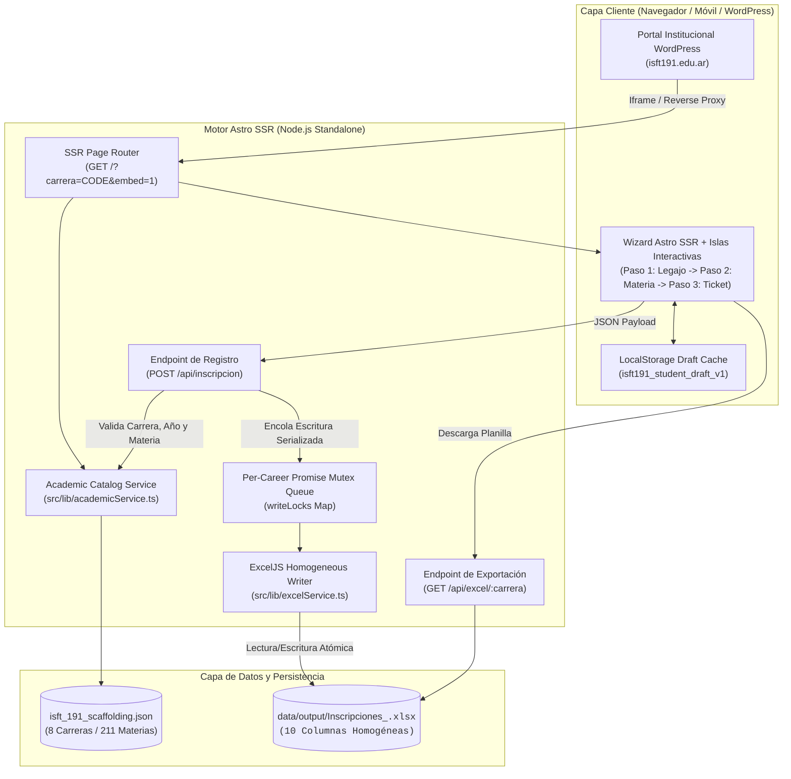
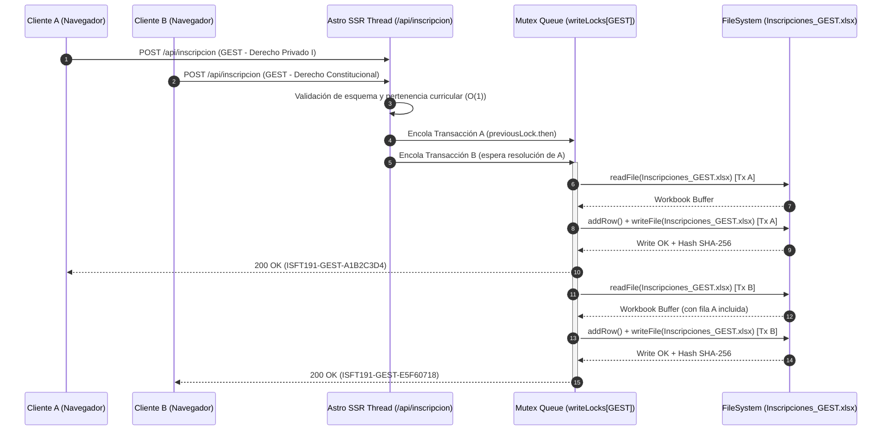

<div align="center">

# Sistema de Inscripción a Exámenes Finales — ISFT N° 191

**Plataforma Académica SSR de Autogestión de Mesas Examinadoras con Persistencia Excel Homogénea y Preparación para SIU Guaraní**

[](https://www.typescriptlang.org/)
[](https://astro.build/)
[](https://isft191.edu.ar)
[](./package.json)
[](https://www.conventionalcommits.org/)
[](#3-arquitectura-del-sistema-y-modelo-de-concurrencia)

</div>

---

## 1. Descripción General y Capacidades Clave

El **Sistema de Inscripción a Exámenes Finales del ISFT N° 191 (Bahía Blanca)** resuelve la fragmentación de formularios estáticos mediante un motor **Server-Side Rendered (Astro SSR)** que unifica las **8 carreras (planes vigentes y en transición) y sus 211 asignaturas** en una única interfaz reactiva. Cada solicitud se valida contra el padrón curricular oficial en el servidor e impacta de forma atómica en libros Excel homogéneos separados por carrera, respetando el esquema estricto de 10 columnas requerido por Secretaría Académica y preparando los payloads para la futura ingesta en **SIU Guaraní**.

### Características Principales
- **Catálogo Académico Verificado (8 Carreras / 211 Materias):** Sincronización 1:1 con el diseño curricular oficial del instituto (`RS 5847/19`, `RS 5309/24`, `RS 1896/09`, `RS 5312-24`, `RS 1557-07`, `RS 455-23`, `RS 273-03` y `RS 4103/03`), incluyendo el desglose individualizado de los Espacios de Definición Institucional (`EDI 1`, `EDI 2` y `EDI 3`).
- **Filtrado Dinámico en Cascada Zero-Reload:** Selección progresiva en memoria (`Carrera` $\rightarrow$ `Año de Cursada (1°, 2°, 3°)` $\rightarrow$ `Materias Habilitadas`) que impide inscripciones cruzadas o errores de tipeo en nombres de asignaturas.
- **Persistencia Excel Homogénea con Cola Mutex por Carrera:** Generación y actualización de archivos `Inscripciones_<CODIGO_CARRERA>.xlsx` mediante `ExcelJS`, protegida por colas de promesas encadenadas en memoria (`writeLocks`) que serializan el acceso a disco y eliminan condiciones de carrera ante picos de inscripción simultáneos.
- **Persistencia Local de Legajo (Draft Caching):** Almacenamiento automático en `localStorage` de los datos personales del alumno (`Apellido y Nombre`, `DNI`, `Teléfono`, `Email`, `Cohorte`) para permitir la inscripción consecutiva a múltiples materias en segundos.
- **Comprobante Criptográfico Instantáneo:** Emisión de ticket único (`ISFT191-<CARRERA>-<SHA256_8>`) con hoja de estilo `@media print` dedicada para descarga directa en PDF.
- **Integración Nativa con WordPress (`isft191.edu.ar`):** Identidad visual alineada con los tokens de color institucionales (`#3438AA`) y soporte de query flags (`?carrera=<CODE>&embed=1`) para incrustación transparente vía `<iframe>` o Reverse Proxy.

---

## 2. Padrón Curricular Sincronizado

| ID | Código | Carrera | Resolución Oficial | 1° Año | 2° Año | 3° Año | Total Materias |
| :-: | :-: | :--- | :-: | :-: | :-: | :-: | :-: |
| 1 | `SOFT` | Tecnicatura Superior en Desarrollo de Software | `RS 5847/19` | 8 | 8 | 6 | **22** |
| 2 | `ADU-5309` | Tecnicatura Superior en Régimen Aduanero | `RS 5309/24` | 8 | 8 | 7 | **23** |
| 3 | `ADU-1896` | Tecnicatura Superior en Régimen Aduanero | `RS 1896/09` | 10 | 8 | 7 | **25** |
| 4 | `LOG-5312` | Tecnicatura Superior en Logística | `RS 5312-24` | 11 | 9 | 9 | **29** |
| 5 | `LOG-1557` | Tecnicatura Superior en Logística | `RS 1557-07` | 9 | 8 | 7 | **24** |
| 6 | `CONT-455` | Tecnicatura Superior en Administración Contable | `RS 455-23` | 8 | 9 | 7 | **24** |
| 7 | `CONT-273` | Tecnicatura Superior en Administración Contable | `RS 273-03` | 13 | 13 | 12 | **38** |
| 8 | `GEST` | Tecnicatura Superior en Gestoría | `RS 4103/03` | 9 | 9 | 8 | **26** |
| — | **Total** | **8 Planes de Estudio** | **Verificados** | **76** | **72** | **63** | **211** |

---

## 3. Arquitectura del Sistema y Modelo de Concurrencia

### 3.1 Diagrama de Flujo de Arquitectura (`flowchart TD`)



### 3.2 Modelo de Concurrencia y Serialización I/O (`sequenceDiagram`)

Para garantizar que dos alumnos de la misma carrera que envían el formulario en el mismo milisegundo no sobrescriban ni corrompan el archivo `.xlsx`, `src/lib/excelService.ts` implementa una cola de exclusión mutua asíncrona por ruta de archivo (`writeLocks`):



---

## 4. Especificación de Interfaces y API HTTP

### 4.1 Parámetros de Vista SSR (`GET /`)

| Query Flag | Tipo | Ejemplo | Descripción |
| :--- | :---: | :--- | :--- |
| `carrera` | `string` | `?carrera=GEST` | Preselecciona automáticamente la carrera en el Paso 2 del formulario. |
| `embed` | `0 \| 1` | `?carrera=SOFT&embed=1` | Oculta el encabezado y pie de página institucional para incrustación limpia dentro de WordPress. |

### 4.2 Registro de Inscripción (`POST /api/inscripcion`)

Valida los datos del alumno y la correlación estricta `Carrera` $\rightarrow$ `Año` $\rightarrow$ `Materia` antes de impactar en el archivo Excel de la carrera.

#### Request Payload (`application/json`)
```json
{
  "apellidoNombre": "Cricelli Candela Juliana",
  "dni": "43596839",
  "telefono": "2914058716",
  "email": "candecricelli21@gmail.com",
  "cohorte": "2023",
  "carreraCode": "GEST",
  "anioMateria": 1,
  "modalidad": "Regular",
  "materiaCodigo": "GEST-102",
  "anioCursado": "2023",
  "profesor": "Crivelli"
}
```

#### Response `200 OK` (`application/json`)
```json
{
  "ok": true,
  "comprobanteId": "ISFT191-GEST-9F4A2C1B",
  "fechaIso": "2026-10-27T13:05:12.410Z",
  "archivoCarrera": "Inscripciones_GEST.xlsx",
  "datos": {
    "carreraCode": "GEST",
    "carreraNombre": "Tecnicatura Superior en Gestoría",
    "carreraResolucion": "RS 4103/03",
    "apellidoNombre": "Cricelli Candela Juliana",
    "dni": "43596839",
    "telefono": "2914058716",
    "email": "candecricelli21@gmail.com",
    "cohorte": "2023",
    "anioMateria": 1,
    "anioMateriaLabel": "Primero",
    "modalidad": "Regular",
    "materiaCodigo": "GEST-102",
    "materiaNombre": "Derecho Constitucional",
    "anioCursado": "2023",
    "profesor": "Crivelli"
  }
}
```

#### Códigos de Estado y Manejo de Errores
- **`200 OK`**: Inscripción persistida en el libro Excel de la carrera y comprobante emitido.
- **`400 Bad Request`**: Fallo de validación defensiva (DNI fuera de rango de 7–9 dígitos, email inválido, cohorte/año de cursado con formato incorrecto, o materia inexistente para la carrera y año indicados).
- **`500 Internal Server Error`**: Error de permisos de sistema de archivos o fallo inesperado en motor de serialización Excel.

### 4.3 Descarga de Planilla Homogénea (`GET /api/excel/:carrera`)

- **Ruta:** `GET /api/excel/GEST` (acepta cualquiera de los 8 códigos: `SOFT`, `ADU-5309`, `ADU-1896`, `LOG-5312`, `LOG-1557`, `CONT-455`, `CONT-273`, `GEST`).
- **Respuesta `200 OK`:** Flujo binario `application/vnd.openxmlformats-officedocument.spreadsheetml.sheet` con las **10 columnas homogéneas exactas**:
  1. `Apellido y Nombre`
  2. `DNI`
  3. `Teléfono`
  4. `Dirección de correo electrónico`
  5. `Cohorte`
  6. `Año al que pertenece la materia que quiere rendir` (`Primero` | `Segundo` | `Tercero`)
  7. `MODALIDAD` (`Regular` | `Libre`)
  8. `MATERIA`
  9. `AÑO DE CURSADO`
  10. `PROFESOR`
- **Respuesta `404 Not Found`:** Código de carrera inválido o carrera aún sin inscripciones registradas en disco.

---

## 5. Runbook: Instalación, Compilación y Verificación

### 5.1 Requisitos Previos
- **Node.js:** `>= 20.0.0` (probado en `v26.11.1`)
- **npm:** `>= 10.0.0`

### 5.2 Clonación e Instalación
```bash
git clone git@github.com:nedder3/formularios-web-isft.git
cd formularios-web-isft
npm install
```

### 5.3 Ejecución en Desarrollo y Compilación de Producción (Release)
```bash
# Servidor de desarrollo con Hot-Reload en http://localhost:4321
npm run dev

# Compilación SSR para producción (salida en ./dist/server/entry.mjs)
npm run build

# Ejecución del servidor Node.js Standalone en producción
npm start
```

### 5.4 Verificación de Integridad del Padrón y Prueba End-to-End
```bash
# 1. Verificar integridad del catálogo JSON (8 carreras, 211 materias)
node -e '
const fs = require("fs");
const data = JSON.parse(fs.readFileSync("./isft_191_scaffolding.json", "utf8"));
const total = data.carreras.reduce((acc, c) => acc + c.materias.length, 0);
console.log(`Carreras: ${data.carreras.length} | Materias totales: ${total}`);
'

# 2. Compilar el proyecto verificando tipos y bundle SSR
npm run build
```
